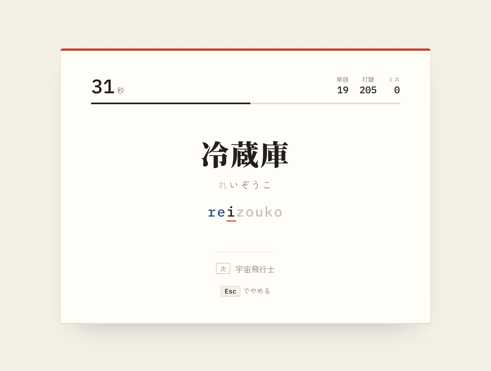
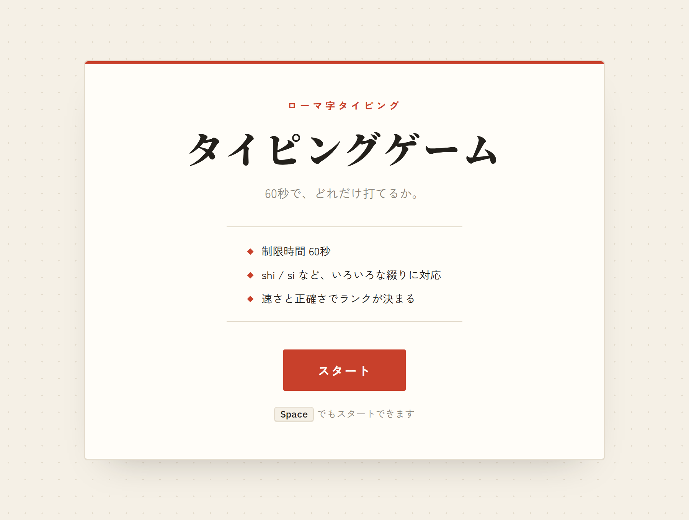
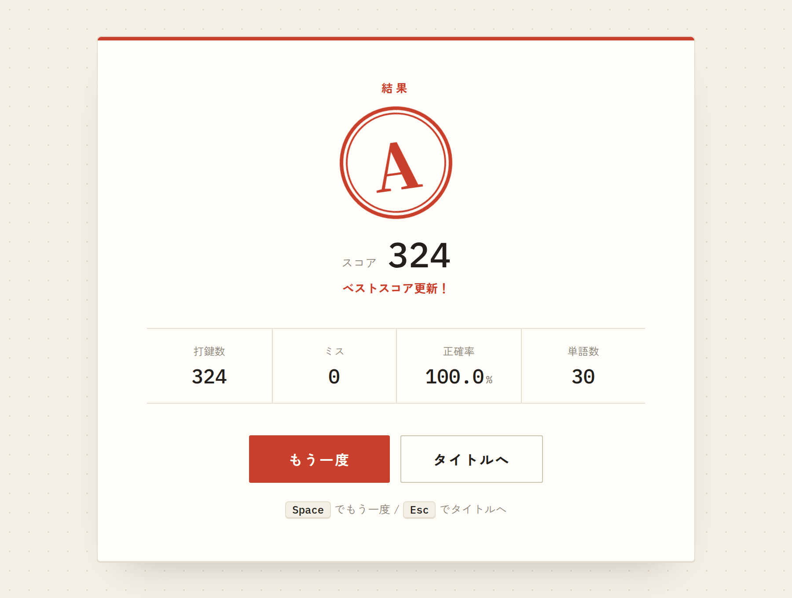
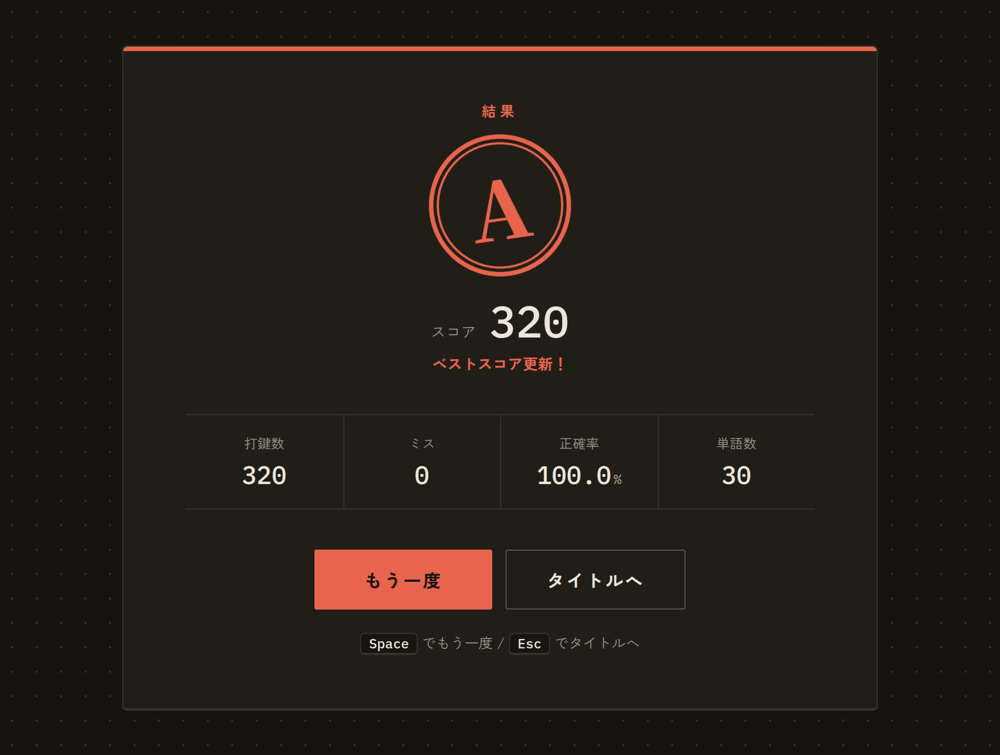

# タイピングゲーム

60秒で何文字打てるかに挑戦する、日本語（ローマ字入力）のタイピングゲームです。
`shi` / `si`、`tsu` / `tu` のような綴りの揺れや、「っ」「ん」の入力方法の違いにも対応しています。

**公開URL**: https://japanese-typing-game-pi.vercel.app

<p align="center">
  
</p>

| スタート画面 | 結果画面 | 結果画面（ダークモード） |
| --- | --- | --- |
|  |  |  |

## 遊び方

1. **スタート**ボタン、または <kbd>Space</kbd> キーで開始します
2. 表示されたお題をローマ字で入力します。打ち終わると次のお題に進みます
3. 60秒経つと結果画面に移り、スコアとランク（S〜D）が表示されます

<kbd>Esc</kbd> でいつでもタイトルに戻れます。

## 主な機能

- **いろいろな綴りに対応したローマ字判定**
  - 例: し = `shi` / `si`、ちゃ = `cha` / `tya` / `chixya`、まっちゃ = `maccha` / `matcha` / `maxtucha`
  - 「ん」は次の文字によって `n` 1回で済むかどうかを判定します（かんじ = `kanji` / `kannji`、こんにちは = `konnnichiha`）
  - 打ち始めた綴りに合わせて、お手本のローマ字表示が変わります
- **入力中の表示**: 入力済みのかな・ローマ字の色分け、次に打つキーの強調、ミスしたときのアニメーション、次のお題の表示
- **スコアとランク**: 1分あたりの打鍵数 × 正確率でスコアを計算し、S〜Dのランクを判子風に表示
- **ベストスコアの保存**: ブラウザ（localStorage）に保存し、更新したときはお知らせします
- **キーボードだけで操作可能**: スタート・リトライ・中断をすべてキーで操作できます
- **ダークモード・スマートフォン幅に対応**

## 使用技術

| 分類 | 技術 |
| --- | --- |
| 言語 | TypeScript |
| UI | React 19 |
| ビルド | Vite |
| テスト | Vitest |
| Lint | Oxlint |
| スタイル | CSS（ライブラリなし） |

## 工夫した点

### 1. ローマ字入力の判定

日本語タイピングで一番難しいのは、1つのかなに複数の打ち方があることです。
[`src/lib/romaji.ts`](src/lib/romaji.ts) では、次の3段階で判定しています。

1. **ひらがなを「入力の単位（チャンク）」に分ける**
   拗音（`しゃ`）は2文字で1単位にします。促音「っ」は次の文字とまとめ（`っせ`）、子音を重ねる入力（`sse`）を候補に加えます。
2. **チャンクごとに、受け付けるローマ字の候補を持たせる**
   「ん」は後ろの文字を見て、`n` 1回でよいか（`kanji`）、`nn` が必要か（`konnnichiha`）を決めます。
3. **1キーごとに、入力がどれかの候補の先頭と一致するかを調べる**
   「ん」を `n` と打った時点では `nn` の途中かもしれないので確定を保留し、次のキーが `n` 以外ならそこで確定して次のチャンクに進みます。

### 2. ロジックとUIの分離、テスト

ローマ字判定やスコア計算は React に依存しない純粋な関数として `src/lib/` にまとめ、Vitest でテストしています。
お題の単語すべてがローマ字に変換できるか（未対応のかなが混ざっていないか）もテストで確認しています。

### 3. ゲームの状態管理

入力のたびに変わる状態（現在の単語・入力位置・打鍵数・ミス数）は `useReducer` でまとめて管理しています。
reducer は「今の状態 + 押されたキー → 次の状態」を返すだけの関数なので、処理の流れを追いやすくなっています。

### 4. ずれないタイマー

`setInterval` の呼ばれた回数で秒数を数えると、タブが裏に回ったときなどに実際の時間とずれてしまいます。
そこで開始時に終了時刻を決めておき、「終了時刻 − 現在時刻」で残り時間を計算しています。

### 5. デザイン

和紙のような背景・墨色の文字・朱色のアクセントで、日本語のタイピングゲームらしさを出しました。
色はすべて CSS 変数で定義し、ダークモードでは変数の値だけを切り替えています。
端末で「視差効果を減らす」設定がされている場合は、アニメーションを止めます。

## ローカルでの起動

Node.js 22.12 以上が必要です。

```bash
npm install
npm run dev     # 開発サーバー（http://localhost:5173）
npm test        # テスト
npm run build   # 本番用ビルド（dist/ に出力）
```

## ディレクトリ構成

```
src/
├── App.tsx                 画面の切り替え（スタート / ゲーム / 結果）
├── components/
│   ├── StartScreen.tsx
│   ├── GameScreen.tsx      キー入力・タイマー・ゲームの状態管理
│   └── ResultScreen.tsx    スコア表示・ベストスコアの保存
├── data/
│   └── words.ts            お題の単語（表示用の文字と読み）
└── lib/
    ├── romaji.ts           ローマ字入力の判定
    ├── score.ts            スコア・ランクの計算
    └── bestScore.ts        ベストスコアの保存と読み込み
```

## 今後やりたいこと

- 開始前の「3, 2, 1」カウントダウン
- 打鍵音・ミス音などの効果音
- 難易度選択（短い単語 / 長い文章）
- 苦手なキーの分析
